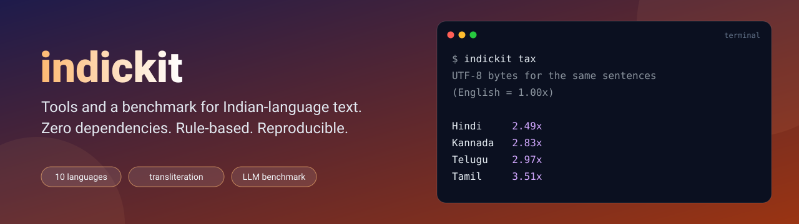
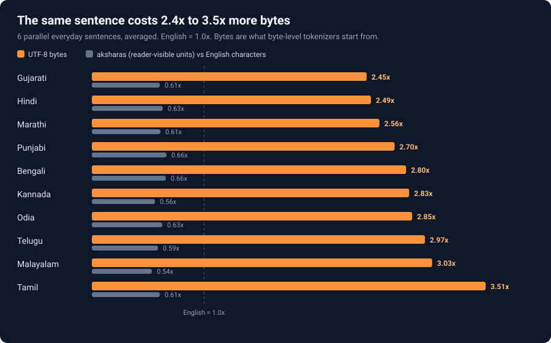
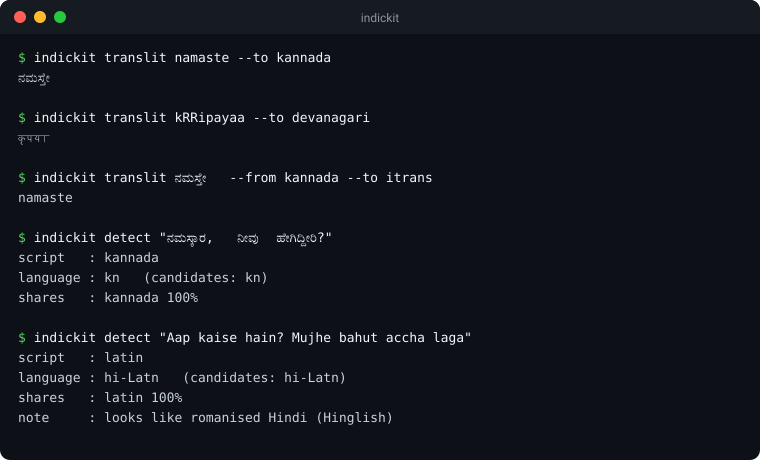

<p align="center">
  
</p>

<p align="center">
  <a href="https://github.com/Gana-Y/indickit/actions/workflows/ci.yml"></a>
  
  
  
  
</p>

<h3 align="center">AI speaks Indian languages. But how well, and at what cost?</h3>

**indickit** is a small, zero-dependency Python toolkit for Indian-language text **plus a reproducible, rule-based benchmark** that tests how well any LLM handles 10 Indian languages. No judge model, no API needed for the toolkit part.

It has two halves:

| 🧰 Toolkit | 📊 Benchmark |
|---|---|
| Script & language detection, code-mixing / Hinglish flag | 5 deterministic task types × 10 languages |
| Unicode normalisation, Indic ↔ ASCII digits | Scored by character n-gram F-score, script checks and exact match |
| Transliteration between 9 scripts and ITRANS (type Kannada on an ASCII keyboard) | Works with OpenAI, Anthropic, Ollama, Groq, Gemini, OpenRouter, vLLM ... |
| Akshara (grapheme) segmentation, "token tax" statistics | Markdown + SVG heatmap reports |

## The token tax

Indian-language text costs more to process. Here is the same set of everyday sentences, counted in the unit a byte-level tokenizer starts from:

<p align="center">
  
</p>

The *visible* text is actually shorter than English (grey bars), but it needs 2.4–3.5× the bytes. Bytes are not tokens: real tokenizers merge bytes into tokens, and how well they do that for each script varies by tokenizer. Measure *your* tokenizer:

```bash
indickit tax                                   # bytes (exact, nothing to install)
pip install "indickit[tokenizers]"
indickit tax --tokenizer tiktoken:o200k_base   # real token counts
indickit tax --tokenizer hf:<repo-id>          # any Hugging Face tokenizer
```

> The chart is computed from the 6 built-in sentences ([`corpus.py`](src/indickit/corpus.py)). Token counts depend on the tokenizer and are not included here. Run the command to see yours.

## Install

```bash
pip install indickit
# or the latest from GitHub:
pip install "git+https://github.com/Gana-Y/indickit.git"
```

Python 3.9+, **no required dependencies**.

## Toolkit

<p align="center">
  
</p>

```python
from indickit import detect, transliterate, normalize, graphemes, to_native_digits, to_latin

detect("ನಮಸ್ಕಾರ, ನೀವು ಹೇಗಿದ್ದೀರಿ?").language          # 'kn'
detect("Aap kaise hain? Mujhe bahut accha laga")     # .romanized == True  ("Hinglish")
detect("Hello ನಮಸ್ಕಾರ friend ಹೇಗಿದ್ದೀರಿ").mixed        # True (code-mixed)

transliterate("namaste", "itrans", "kannada")        # 'ನಮಸ್ತೇ'
transliterate("namastE", "itrans", "kannada")        # 'ನಮಸ್ತೆ'   (E = short e)
transliterate("ಕನ್ನಡ", "kannada", "devanagari")      # 'कन्नड'
to_latin("ಕನ್ನಡ")                                    # 'kannaDa'

normalize("೧೨೩ ಕನ್ನಡ\u200b  ಭಾಷೆ", digits="ascii")      # '123 ಕನ್ನಡ ಭಾಷೆ'
to_native_digits("2024", "kannada")                  # '೨೦೨೪'
graphemes("ಕನ್ನಡ")                                   # ['ಕ', 'ನ್ನ', 'ಡ']
```

### Transliteration: what it is and isn't

Nine Indian scripts (Devanagari, Bengali, Gurmukhi, Gujarati, Odia, Tamil, Telugu, Kannada, Malayalam) share one Unicode layout, so converting *script to script* is a code-point offset, which is exact for the shared core letters. Latin input uses an **ITRANS-style** scheme through a Devanagari pivot.

- It converts *how text is written*, **not language**. It does not translate.
- A consonant followed by another consonant forms a conjunct: `kSha` → क्ष, `namaste` → नमस्ते. A consonant at the end of a word keeps its inherent vowel, so `raam` and `raama` both give राम. Going the other way, राम is written `raama` (strict; there is no Hindi schwa-deletion).
- Long vowels: `aa ii uu` (or `A I U`). Retroflex: `T Th D Dh N`. Sibilants: `sh`=श `Sh`=ष. `RRi`=ऋ, `M`=ं, `H`=ः, `.N`=ँ, `|`=।
- Dravidian **short** e/o are `E` / `O`; plain `e` / `o` are the long ones. That is why `namaste` → ನಮಸ್ತೇ and `namastE` → ನಮಸ್ತೆ.
- **To Tamil is lossy.** Tamil has no separate aspirated/voiced letters, so भारत → பாரத. Characters a script lacks are left unchanged.
- Casual "Hinglish" typing (`mera naam...`) is *not* ITRANS and will not convert the way you mean.

### Detection: what to trust

- **Script: reliable** (it's Unicode blocks).
- **Language:** exact for scripts used by a single language here (Kannada, Telugu, Tamil, Malayalam, Gujarati, Gurmukhi, Odia). For **Devanagari** (Hindi/Marathi/Nepali) and **Bengali-script** (Bengali/Assamese) it uses small stop-word lists, which is a heuristic and unreliable on very short text.
- Romanised Hindi detection is a word-list heuristic.

## Benchmark

Five task types, each scored by a rule, so there is no judge model to trust or pay for:

| Task | Prompt asks the model to... | Scored by |
|---|---|---|
| `translate` | translate an English sentence into language X | chrF vs a reference (+ script check) |
| `respond` | write a sentence in X, in X's script only | share of letters in the right script |
| `translit` | write an ITRANS word in X's script | chrF + exact match (reference from this toolkit) |
| `numerals` | write 2024 / 1234567 in native digits | exact match |
| `script_id` | name the script of a given sentence | exact match |

```bash
# sanity-check the harness with no API at all
indickit bench run --provider mock-oracle -o /tmp/oracle.json

# local, free:
indickit bench run --provider ollama --model llama3.2 -o results/llama3.2.json

# hosted:
export OPENAI_API_KEY=...        # or ANTHROPIC_API_KEY, GROQ_API_KEY, GEMINI_API_KEY, OPENROUTER_API_KEY
indickit bench run --provider openai --model <model> -o results/my-model.json
indickit bench run --provider anthropic --model <model> -o results/my-model.json
indickit bench run --provider openai --base-url http://localhost:8000/v1 --model mine   # vLLM, LM Studio...

indickit bench run ... --langs kn,hi,ta --kinds translate,numerals --limit 3    # a quick, cheap slice
indickit bench report results/my-model.json --svg results/my-model.svg          # Markdown table + SVG heatmap
```

Model names change quickly. Check your provider's docs for current ones.

**No model results are published in this repository yet.** The harness is tested end-to-end with a mock "oracle" model (always right, scores ≈100) and an "echo" baseline (scores ≈0). Real model numbers should come from real runs, so please [submit yours](results/README.md); each result file contains every prompt, response and score so it can be audited.

### Limits (please read)

- The corpus is a **small seed set (6 sentences × 10 languages)**, drafted with AI assistance and **not yet reviewed by native speakers**. Treat scores as a smoke test, not a ranking. Reviewing the sentences is the best first contribution.
- chrF measures overlap with *one* reference. A correct but differently-worded translation scores below 100.
- Rule-based scoring can't judge fluency, tone or factual accuracy.
- Tamil is excluded from the transliteration task because ITRANS cannot represent Tamil's letter inventory exactly.
- One run at temperature 0 is a sample, not a distribution.

## Python API for the benchmark

```python
from indickit import bench
from indickit.llm import make_provider
from indickit.report import to_markdown

tasks = bench.build_tasks(langs=["kn", "hi"], limit_per_cell=3)
data = bench.run(make_provider("ollama", "llama3.2"), tasks, workers=4)
print(to_markdown(data))
```

## Roadmap

- [ ] Native-speaker review of the corpus; more sentences per language
- [ ] More languages (Assamese, Nepali, Sanskrit, Konkani ...) and Urdu (Perso-Arabic script)
- [ ] Longer tasks: summarisation, QA, code-mixed input
- [ ] Optional Hindi schwa-deletion and a Hinglish → Devanagari model
- [ ] Public leaderboard from community result files

## Development

```bash
git clone https://github.com/Gana-Y/indickit.git && cd indickit
pip install -e ".[dev]"
pytest
python examples/quickstart.py
```

## ⭐ Explore My Other Repositories

| Repository | Description | Domain |
| :--- | :--- | :--- |
| 🏦 [**bankstmt**](https://github.com/Gana-Y/bankstmt) | 100% offline Indian bank statement PDF converter to clean CSV/JSON/Excel with row-by-row balance checks. | `FinTech / PDF Parser` |
| 🚀 [**Florix_AI**](https://github.com/Gana-Y/Florix_AI) | Production-grade multimodal AI study platform with in-database RAG and adaptive spaced repetition. | `Full-Stack RAG / AI` |
| ⚡ [**vesper-engine**](https://github.com/Gana-Y/vesper-engine) | High-performance sandboxed code execution engine & 7-state POSIX arbiter with Linux cgroups v2. | `Systems / Sandbox` |
| 📈 [**OrderCore**](https://github.com/Gana-Y/OrderCore) | High-throughput Limit Order Book & matching engine in Python (FastAPI/WebSockets) achieving 136k orders/sec. | `Low-Latency Systems / FinTech` |
| 🔌 [**Supercharged-MCP**](https://github.com/Gana-Y/Supercharged-MCP) | Model Context Protocol handbook: 25+ production servers, Python FastMCP & TS SDK starters, Docker sandbox. | `Anthropic MCP Production Kit` |

## 👨‍💻 Author & Maintainer

Maintained with ❤️ by **[Ganesh Yandigeri](https://github.com/Gana-Y)**

- 🌐 **Portfolio:** [ganesh-portfolio-silk-five.vercel.app](https://ganesh-portfolio-silk-five.vercel.app)
- 💼 **LinkedIn:** [linkedin.com/in/ganesh-yandigeri](https://linkedin.com/in/ganesh-yandigeri)
- 🐙 **GitHub:** [@Gana-Y](https://github.com/Gana-Y)

## License

[MIT](LICENSE) © 2026 Ganesh Yandigeri

---

<p align="center"><sub>Built for the next billion users who think in more than one script. A ⭐ helps others find it.</sub></p>
